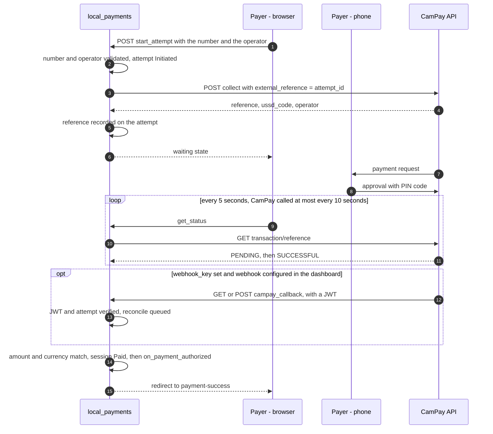

# CamPay Gateway

This document describes the integration of CamPay into `local_payments`:
configuration, operations called, status mapping, and rules specific to this
provider. Rules common to all gateways (session, attempt, reconciliation,
consumer callback) are in [`../ARCHITECTURE.md`](../ARCHITECTURE.md). Why it is
integrated this way: [ADR 0005](../decisions/0005-campay-aggregator.md).

## Product

CamPay Collect API, Cameroon. The site sends a payment request (USSD push) to
the payer's mobile money account. CamPay deduces the operator, MTN MoMo or
Orange Money, from the number. The payer approves it on their phone. CamPay's
payment links are not used: entering the number, choosing the operator and
waiting happen on the local `local_payment_checkout` page.

CamPay is an aggregator: it holds the funds, as Nokash does.

## Merchant prerequisites

- A CamPay application, sandbox (`demo.campay.net`) or production
  (`www.campay.net`), with its permanent access token and its webhook key
  (dashboard, "API ACCESS KEYS"). The username and password of the temporary
  token flow are not used.
- API withdrawals left disabled in the application's settings: the token does
  not expire, and only collects are needed.
- For the webhook, a public `https://` address in the site's `host_name`, and
  the address shown in `webhook_url` entered in the dashboard, with GET or POST.
- The sandbox accepts only its four test numbers and at most 100 XAF.

## Configuration

Doctype `CamPay Settings`, not Single, named by `gateway_name`. Only System
Manager can read or edit it.

| Field                       | Type     | Required | Role |
| --------------------------- | -------- | -------- | ---- |
| `gateway_name`            | Data     | yes      | Application name. Gives its name to the document and to the `CamPay-<gateway_name>` gateway. A change after the document is created is refused. |
| `enabled`                 | Check    |          | A disabled gateway refuses `get_payment_url()`. Unchecked by default. |
| `environment`             | Select: Sandbox, Production | yes | Defaults to Sandbox. Switching it moves `api_base_url` to the other default while it still holds one. With Production, the warning about a missing `Local Payments Manager` applies, and an enabled gateway with a `webhook_key` needs an `https://` `host_name`. |
| `api_base_url`            | Data     | yes      | Defaults to `https://demo.campay.net/api`. Must start with `https://`: the token is sent to it. |
| `access_token`            | Password | yes      | Permanent access token, sent as `Authorization: Token <token>`. |
| `webhook_key`             | Password |          | Checks the webhook's JWT. Empty: every webhook call is refused, and only status checks settle attempts. |
| `webhook_url`             | Data, read only |   | Filled on save from `host_name`: `<host_name>/api/method/local_payments.api.campay_callback`. To copy into the dashboard. |
| `accept_mtn_momo`         | Check    |          | Offers MTN MoMo to the payer. Checked by default. |
| `accept_orange_money`     | Check    |          | Offers Orange Money to the payer. Checked by default. At least one operator is required. |
| `pending_timeout_minutes` | Int      |          | Local delay before `Unresolved`. Defaults to 15, also when left empty or set to 0. Cannot be negative. |
| `minimum_amount`          | Int      |          | Smallest amount a payment request can ask for, in XAF. Defaults to 1, also when left empty or set to 0. Cannot be negative. |
| `maximum_amount`          | Int      |          | Largest amount, in XAF. 0, the default, means no cap. Set 100 for the sandbox. Cannot be below `minimum_amount`. |
| `payment_description`     | Data     |          | Sent as `description`, shown to the payer. `{title}` is replaced by the session title. Defaults to `{title}`. No number or personal data. |

The currency (`XAF`), the country code (`237`) and the length of the national
number (9) are not settings: they are constants of
`local_payments/providers/campay.py`.

Saving the document creates the `CamPay-<gateway_name>` gateway if it does not
exist yet, and announces it with `payment_gateway_enabled` when `enabled` is
checked. A site can hold several documents, for instance one Sandbox and one
Production.

## Operations

| Operation | Request | Useful response |
| --------- | ------- | --------------- |
| Collect | `POST {api_base_url}/collect/`. Header `Authorization: Token <access_token>`. JSON body: `amount` (whole XAF as a string), `currency` (`XAF`), `from` (`237` + 9 digits), `description`, `external_reference` (the `attempt_id`) | 200: `reference`, `ussd_code`, `operator`. 400: `error_code`, `message` |
| Status | `GET {api_base_url}/transaction/{reference}/`. Same header | `reference`, `status`, `amount`, `currency`, `external_reference`, `reason`, `code`, `operator` |
| Incoming webhook | GET (query string) or POST (JSON body) on `/api/method/local_payments.api.campay_callback`, when the transaction becomes `SUCCESSFUL` or `FAILED`. Parameters: `status`, `reference`, `external_reference`, `amount`, `currency`, `signature` (JWT) and others | Serves only as a trigger, once verified. 401 when the JWT or the attempt cannot be verified |

The contract used is in
[`../openAPI/campay-collect-spec.json`](../openAPI/campay-collect-spec.json):
what the sandbox answered on 2026-11-24, which wins where the official
documentation disagrees. The client is `local_payments/providers/campay.py`.
It reports what CamPay answered and leaves the attempt status to its caller.

## Status mapping

| CamPay response | Attempt status | Note |
| --------------- | -------------- | ---- |
| 200 with a `reference` on collect | `Initiated` | `reference` is recorded on the attempt. Only a status check decides. |
| 400 `ER101`, `ER102` or `ER201` on collect | `Error` | Number or amount refused, nothing created. Logged in Error Log. The payer can try again. |
| 401 or 403 on collect | `Error` | The token was refused. Logged, managers alerted once per attempt. |
| 429 `DUPLICATE_ATTEMPT` on collect | `Initiated`, no reference | A transaction may exist under this `external_reference`. Never sent again. |
| Timeout, `5xx`, redirect, unreadable body, other `429` or `400`, 200 without a usable `reference` on collect | `Initiated` | The outcome is unknown: the request may have reached the payer's phone. |
| `PENDING` | `Pending` | Waiting for the payer. |
| `SUCCESSFUL` | `Succeeded` | Amount and currency compared to the session. |
| `FAILED` | `Failed` | Declined, failed or abandoned. |
| `PENDING` after `pending_timeout_minutes` | `Unresolved` | CamPay has no expiry status. Queried thereafter at decreasing frequency. |
| No reference on the attempt | `Pending`, then `Unresolved` at the deadline | No call goes out. See "Lost reference". |
| Status 404, 5xx, timeout, unreadable body, unknown `status`, or `reference` / `external_reference` that is not the attempt's | No change, then `Unresolved` at the deadline | Reported as an error, logged, queried again later. The failed query proves nothing about the payment. |
| 401 or 403 on status | Same, and the managers are alerted once per attempt | The token was refused. No retry fixes it. |

`provider_status` keeps the status and `reason` together, for instance
`FAILED: TESTING`. CamPay writes the string `None` in `reason` until a
transaction fails; that value is dropped. The reason is only copied, never
used to decide anything.

## Flow

## Rules specific to CamPay

- **`external_reference`.** It receives the `attempt_id`, a UUID4 as CamPay
  requires, so a CamPay transaction can always be traced back to its attempt.
  The status answer and the webhook carry it back.
- **Reference.** `reference` is the only key the status operation accepts. It
  is stored in `provider_transaction_id` as soon as the collect answers. It
  goes into the status URL, so only letters, digits and `-` are accepted.
- **Lost reference.** Without a collect answer, the attempt has no reference to
  check with. It stays open until `pending_timeout_minutes`, then moves to
  `Unresolved`, and the managers are alerted once. Looking a transaction up by
  `external_reference` is not documented, so support checks in the dashboard
  with the `attempt_id`.
- **No retry.** The sandbox answers 429 `DUPLICATE_ATTEMPT` to a repeated
  `external_reference` while the first transaction is pending, and the
  behaviour afterwards is unknown. A collect is sent once.
- **Amount.** A whole number of XAF, sent as a string: `"100"`. A fraction is
  refused when the session is created, never rounded. So is an amount below
  `minimum_amount` or above a non-zero `maximum_amount`, in `get_payment_url()`
  and in `validate_minimum_transaction_amount()`, which ERPNext calls first.
- **Sandbox amount.** The sandbox reports `amount` `0.00` even on
  `SUCCESSFUL`. Such a success ends as `Succeeded` with `amount_mismatch`, and
  the session stays `Open`. There is no sandbox exception to the amount check.
- **Number.** Sent as `237` followed by the 9-digit national number. The prefix
  must belong to the chosen operator. CamPay picks the operator from the number
  and answers `ER101` for an unsupported one.
- **Operator.** As with Nokash: the page offers the operators checked on the
  settings, and the choice is kept in `provider_data` for the number check. It
  is not sent to CamPay.
- **Secrets.** The token travels in the `Authorization` header, never in the
  network log. Redirects are not followed: they would send the token to another
  address. A failed status call raises without its transport error.
- **Network log.** One `Integration Request` per attempt: the collect URL, the
  body, and CamPay's status code and body, cut at 2,000 characters.
  `Completed` when CamPay accepted the collect, `Failed` otherwise. Status
  queries are not logged there.
- **Rate.** CamPay documents no limit. The site-wide minimum of 10 seconds
  between two status calls per attempt applies.
- **Webhook.** Sent once, never retried, so the outcome must never depend on
  it: page polling and the scheduler stay the reliable path. The endpoint reads
  `external_reference` and `signature` from the query string (GET) or the JSON
  body (POST). The JWT must be HS256, signed with the attempt's own gateway's
  `webhook_key`, within `nbf` and `exp` give or take 60 seconds, and
  `external_reference` and `reference` must be the attempt's. Anything it cannot
  verify, an unknown attempt included, gets 401 and queues nothing. A verified
  call for a running attempt queues `reconcile()`, at most one job per attempt.
  The JWT names no transaction: it proves the call comes from CamPay and
  nothing about the parameters next to it, which are never read for the
  outcome. A token replayed within its hour can only trigger a status check.

## Known errors

| Answer | Meaning | Handling |
| ------ | ------- | -------- |
| 400 `ER101` on collect | Invalid number, or a well-formed number of an unsupported operator | Attempt `Error`, Error Log entry with the code, without the payer's number. |
| 400 `ER102` on collect | Unsupported operator, per the documentation. Not seen in the sandbox | Same as `ER101`. |
| 400 `ER201` on collect | Decimal, zero, or above the sandbox maximum (100 XAF) | Attempt `Error`. |
| 401 or 403 | Token refused (code not captured, assumed) | On collect, attempt `Error` and managers alerted. On status, no change and managers alerted. |
| 429 `DUPLICATE_ATTEMPT` on collect | `external_reference` already being processed | Attempt `Initiated` without reference. |
| 404 on status | Unknown reference | No change until the deadline, then `Unresolved`. |
| Other value, `5xx`, no answer or unreadable body | The call failed, not the payment | Collect: `Initiated`. Status: no change until the deadline. |

## Points to confirm before production

| Point | Assumption made | Effect if the assumption is wrong |
| ----- | --------------- | --------------------------------- |
| `amount` and `currency` on a production `SUCCESSFUL` | Filled with the real values | If `0.00` as in the sandbox, no CamPay session is ever `Paid`. Check with one small real payment before opening the gateway. |
| HTTP code for a missing, invalid or regenerated token | 401 or 403 | Another code leaves attempts `Initiated` without an alert. |
| Rate limit on status | None below one call every 10 seconds | Ask CamPay. The official SDK polls every 3 seconds. |
| Longest real `PENDING` | Under 15 minutes | Adjust `pending_timeout_minutes`. |
| Production amount limits per operator | Unknown | Set `minimum_amount` and `maximum_amount`. A session outside them ends in `ER201`. |
| Repeated `external_reference` after the first transaction ends | Unknown, so never repeated | None while there is no retry. |
| Webhook JWT claims on a real delivery | Same as the status answer's `signature` (`nbf`, `exp` = `iat` + 3600) | Genuine webhooks are refused. None for the outcome: polling still settles it. |
| Webhook `reference` | CamPay's transaction reference, as on collect | Same as above. |
| Test responses | Built from the specification (`local_payments/tests/fixtures/campay.json`) | Replace them with captures, token and numbers removed. |

## References

| Source | Nature | Scope | Content used |
| ------ | ------ | ----- | ------------ |
| CamPay Postman documentation, `documenter.getpostman.com/view/2391374/T1LV8PVA`, read on 2026-11-24 | Official | Sandbox and production | Operations, fields, errors, webhook. |
| Sandbox calls of 2026-11-24 with a permanent token, transcribed in [`../openAPI/campay-collect-spec.json`](../openAPI/campay-collect-spec.json) | Observed | Sandbox | `DUPLICATE_ATTEMPT`, `ER101` for an unsupported operator, `0.00` amounts, timings, JWT claims. Wins over the documentation. |
| [`campay-integration-plan.md`](campay-integration-plan.md), 2026-11-24 | Internal | — | Design, reuse map, decisions, open questions. |
