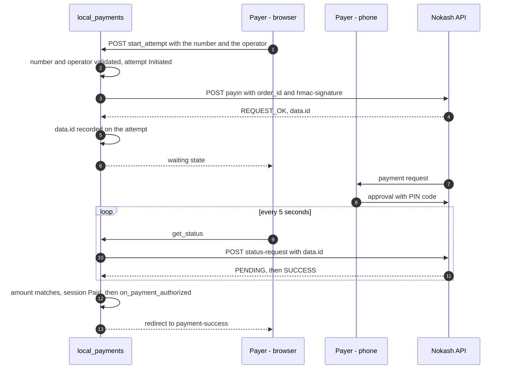

# Nokash Gateway

This document describes the integration of Nokash into `local_payments`:
configuration, operations called, status mapping, and rules specific to this
provider. Rules common to all gateways (session, attempt, reconciliation,
consumer callback) are in [`../ARCHITECTURE.md`](../ARCHITECTURE.md). Why it is
integrated this way: [ADR 0003](../decisions/0003-nokash-aggregator.md).

## Product

Nokash Payin API, Cameroon. The site sends a payment request to the payer's
mobile money account, through MTN MoMo or Orange Money. The payer approves it
on their phone. Nokash hosts no payment page: entering the number, choosing
the operator and waiting happen on the local `local_payment_checkout` page.

## Merchant prerequisites

- A Nokash account, with an integrator key and an app key.
- Production keys for the callback, which Nokash does not send in the sandbox.

## Configuration

Doctype `Nokash Settings`, not Single, named by `gateway_name`. Only System
Manager can read or edit it.

| Field | Type | Required | Role |
| --- | --- | --- | --- |
| `gateway_name` | Data | yes | Contract name. Gives its name to the document and to the `Nokash-<gateway_name>` gateway. A change after the document is created is refused. |
| `enabled` | Check | | A disabled gateway refuses `get_payment_url()`. Unchecked by default. |
| `api_base_url` | Data | yes | Defaults to `https://api.nokash.app`. Must start with `https://`: the keys are sent to it. |
| `i_space_key` | Password | yes | Integrator key. Sent in the payin body and used as the HMAC key. |
| `app_space_key` | Password | yes | App key. Sent in the payin body and part of the signed string. |
| `accept_mtn_momo` | Check | | Offers MTN MoMo to the payer. Checked by default. |
| `accept_orange_money` | Check | | Offers Orange Money to the payer. Checked by default. At least one operator is required. |
| `pending_timeout_minutes` | Int | | Local delay before `Unresolved`. Defaults to 15, also when left empty or set to 0. Cannot be negative. |

The currency (`XAF`), the country code (`237`) and the length of the national
number (9) are not settings: the Nokash offer in use covers Cameroon only. They
are constants of `local_payments/providers/nokash.py`.

## Operations

| Operation | Request | Useful response |
| --- | --- | --- |
| Payin | `POST {api_base_url}/lapas-on-trans/trans/api-payin-request/407`. Header `hmac-signature`. Body: `i_space_key`, `app_space_key`, `payment_type`, `country`, `payment_method`, `order_id` (the `attempt_id`), `amount`, `user_data.user_phone` | `status`, `data.id` |
| Status | `POST {api_base_url}/lapas-on-trans/trans/310/status-request?transaction_id=<data.id>`, no body | `status`, `data.status`, `data.statusReason`, `data.amount` |

Every answer has the same envelope: `status` (`REQUEST_OK`, `REQUEST_BAD_INFOS`
or any other value), `message`, and `data`, filled only on `REQUEST_OK`. The
full contract is in
[`../openAPI/nokash-payin-spec.json`](../openAPI/nokash-payin-spec.json). The
client is `local_payments/providers/nokash.py`. It reports what Nokash answered
and leaves the attempt status to its caller.

## Status mapping

| Nokash response | Attempt status | Note |
| --- | --- | --- |
| `REQUEST_OK` on payin | `Initiated` | `data.id` is recorded on the attempt. `data.status` is ignored, even when it is already final: only a status check decides. |
| `REQUEST_BAD_INFOS` on payin | `Error` | Nokash created nothing. Logged in Error Log. The payer can try again. |
| Timeout, `5xx`, redirect, unreadable body, `REQUEST_OK` with no `data.id`, or any other value on payin | `Initiated` | The outcome is unknown: the request may have reached the payer's phone. |
| `PENDING` | `Pending` | Waiting for the payer. |
| `SUCCESS` | `Succeeded` | Amount compared to the session. |
| `FAILED` | `Failed` | Declined, or insufficient balance. |
| `CANCELED` | `Failed` | Cancelled by the payer. |
| `TIMEOUT` | `Expired` | No response from the operator in time. |
| `PENDING` after `pending_timeout_minutes` | `Unresolved` | Queried thereafter at decreasing frequency. |
| No Nokash id on the attempt | `Pending`, then `Unresolved` at the deadline | No call goes out. See "Lost id". |
| Anything other than `REQUEST_OK` on status, an unknown transaction status, or an unreadable body | No change | Reported as an error, logged, queried again later. |

`provider_status` keeps the status and `statusReason` together, for instance
`FAILED: Insufficient customer balance`. The reason is only copied, never used
to decide anything.

## Flow

## Rules specific to Nokash

- **`order_id`.** It receives the `attempt_id`, so a Nokash transaction can
  always be traced back to the attempt that started it.
- **Transaction id.** `data.id` is the only key the status operation accepts,
  and the reference support searches on. It is stored in
  `provider_transaction_id` as soon as the payin answers.
- **Lost id.** Without a payin answer, the attempt has no id to check with. It
  stays open until `pending_timeout_minutes`, then moves to `Unresolved`, and
  the managers are alerted at once, once, even if the session has been paid
  since: the payer may have been charged. No status query can settle it, so
  none goes out, and support checks with Nokash using the `attempt_id`.
- **No retry.** Nokash does not say whether a repeated `order_id` is refused or
  creates a second transaction, so a payin is sent once.
- **Signature.** HMAC-SHA256 in lowercase hexadecimal, keyed by `i_space_key`,
  over `{order_id}:{amount}:{user_phone}:{app_space_key}`. `amount` and
  `user_phone` are the values of the JSON body.
- **Amount.** A whole number of XAF, sent as a JSON integer: `1000`, never
  `1000.0`. A fraction is refused before any call, never rounded. The minimum
  is not checked locally: Nokash answers `REQUEST_BAD_INFOS` below it.
- **Number.** Sent as the national number, without the country code. The
  attempt keeps the full number.
- **Operator.** The page offers the operators checked on the settings, with no
  default, so a request is not sent to the wrong operator by accident. With one
  operator checked, the page asks nothing. The choice is kept in the attempt's
  `provider_data`.
- **Currency.** The status answer has none, so the client reports `XAF`, the
  only currency of the contract. Only the amount is really confirmed.
- **Secrets.** The keys travel in the body, so the client removes them, with
  the signature, from what it hands over for logging, including an answer that
  would repeat them. Redirects are not followed: a `307` would send the keys
  to another address.
- **Network log.** One `Integration Request` per attempt: the payin URL, the
  body without the keys, and Nokash's status code and body, cut at 2,000
  characters. `Completed` when Nokash accepted the payin, `Failed` otherwise.
  Status queries are not logged there.
- **Initiation window.** As with MTN, no status query goes out before the payin
  has answered, or before the window ends if the process died.
- **Callback.** Planned for production, since Nokash does not send it in the
  sandbox. `NokashClient.payin()` takes an optional `callback_url`, which
  nothing passes yet. The body will be a trigger only, as with MTN. No endpoint
  exists today: the outcome is found by polling.

## Known errors

| Answer | Meaning | Handling |
| --- | --- | --- |
| `REQUEST_BAD_INFOS` on payin | Missing field, amount below the minimum, unsupported operator | Attempt `Error`. Error Log entry with the code, without the payer's number. No alert. |
| No answer, `5xx`, other value on payin | Unavailability, or an error Nokash does not name | Attempt `Initiated`, status query scheduled if an id is known. |
| `REQUEST_BAD_INFOS` on status, `404` included | Unknown transaction | No change to the attempt. The error goes to the Error Log and the attempt is queried again later. |
| Other value, `5xx`, no answer or unreadable body on status | The query failed, not the payment | Same as above. |

## Points to confirm before production

| Point | Assumption made | Effect if the assumption is wrong |
| --- | --- | --- |
| Authentication of the status call | None, as in the sandbox | Add it in `NokashClient.check_status`. |
| Signature of the callback | Unknown | To decide when the callback is written. |
| Search for a transaction by `order_id` | Not available | If it exists, a lost id can be recovered automatically. |
| Repeated `order_id` | Unknown, so a payin is never repeated | None while there is no retry. |
| Country code in `user_phone` | National number only | One line in the client, and the test vector. |
| Official HMAC test vector | The vector of the specification, computed by us | Replace it. If it differs, review the signed string. |
| Minimum amount | 200 XAF in the sandbox, not held locally | None. A session below it ends in a refusal. |
| Answer to invalid or expired keys | An unknown outcome, then an alert per attempt | If it is `REQUEST_BAD_INFOS`, attempts end in `Error` instead. |
| Number that does not belong to the chosen operator | `FAILED` on status | Adapt the mapping if Nokash refuses it at payin. |
| Delay of `TIMEOUT` | 15 minutes locally | Adjust `pending_timeout_minutes`. |
| Test responses | Rebuilt from the specification (`local_payments/tests/fixtures/nokash.json`) | Replace them with captures, keys and numbers removed. |
| Server-callable sandbox keys and test numbers | Not available | Blocks validation against a real Nokash environment. |

## References

| Source | Nature | Scope | Content used |
| --- | --- | --- | --- |
| Nokash sandbox — `nokash.co/sandbox`, transcribed in [`../openAPI/nokash-payin-spec.json`](../openAPI/nokash-payin-spec.json), read on 2026-11-06 | Official, simulated API | Sandbox, Cameroon | Operations, signature, statuses, errors, callback. |
| NOKASH API_PAYIN Documentation v4, July 2024 | Official, superseded | Not stated | Callback sent with production keys only. Replaced by the sandbox for the rest (it has no HMAC signature and a minimum of 1 XAF). |
