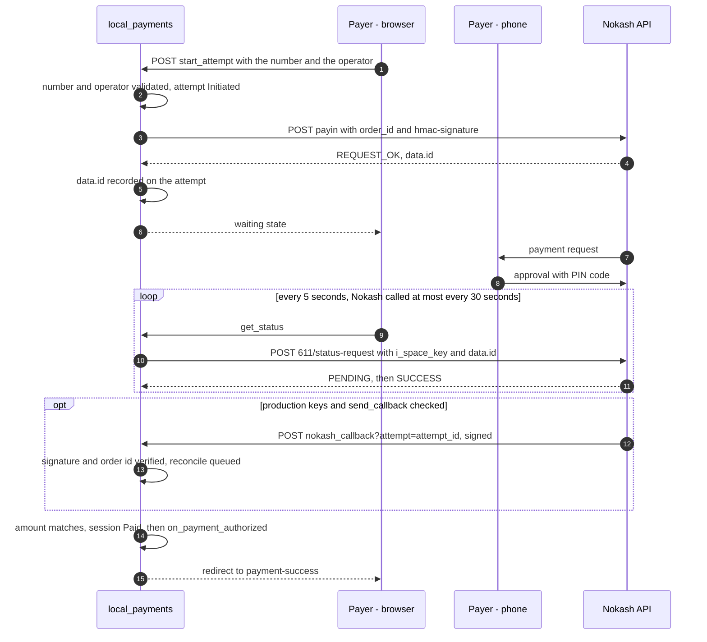

# Nokash Gateway

This document describes the integration of Nokash into `local_payments`:
configuration, operations called, status mapping, and rules specific to this
provider. Rules common to all gateways (session, attempt, reconciliation,
consumer callback) are in [`../ARCHITECTURE.md`](../ARCHITECTURE.md). Why it is
integrated this way: [ADR 0003](../decisions/0003-nokash-aggregator.md).

## Product

Nokash Payin API, Cameroon. The site sends a payment request to the payer's
mobile money account, through MTN MoMo or Orange Money. The payer approves it
on their phone. Nokash hosts no payment page: entering the number, choosing
the operator and waiting happen on the local `local_payment_checkout` page.

## Merchant prerequisites

- A Nokash account, with an integrator key and an app key.
- Production keys for the notification, which Nokash does not send in the sandbox. Before Nokash has the
  site's addresses, the production keys work only with the `X-NK-Integration` header (the `integration_key`
  field): any IP address is accepted, each transaction is capped at 1,000 XAF, and only the integration
  routes are open (authentication, payin, payout, balance, Check Status 611). Once Nokash has declared the
  addresses, the same calls go without the header and without the cap: empty the field.
- The sandbox keys simulate payins, which complete by themselves. They send no notification.
- For the notification, a public `https://` address in the site's `host_name`.

## Configuration

Doctype `Nokash Settings`, not Single, named by `gateway_name`. Only System
Manager can read or edit it.

| Field                       | Type     | Required | Role                                                                                                                                           |
| --------------------------- | -------- | -------- | ---------------------------------------------------------------------------------------------------------------------------------------------- |
| `gateway_name`            | Data     | yes      | Contract name. Gives its name to the document and to the `Nokash-<gateway_name>` gateway. A change after the document is created is refused. |
| `enabled`                 | Check    |          | A disabled gateway refuses `get_payment_url()`. Unchecked by default.                                                                        |
| `environment`             | Select: Sandbox, Production | yes | Defaults to Sandbox. With Production, the warning about a missing `Local Payments Manager` applies, and `send_callback` needs an `https://` `host_name`. |
| `api_base_url`            | Data     | yes      | Defaults to `https://api.nokash.app`. Must start with `https://`: the keys are sent to it.                                                 |
| `i_space_key`             | Password | yes      | Integrator key. Sent in the payin body and used as the HMAC key.                                                                               |
| `app_space_key`           | Password | yes      | App key. Sent in the payin body and part of the signed string.                                                                                 |
| `accept_mtn_momo`         | Check    |          | Offers MTN MoMo to the payer. Checked by default.                                                                                              |
| `accept_orange_money`     | Check    |          | Offers Orange Money to the payer. Checked by default. At least one operator is required.                                                       |
| `pending_timeout_minutes` | Int      |          | Local delay before `Unresolved`. Defaults to 15, also when left empty or set to 0. Cannot be negative.                                       |
| `minimum_amount`          | Int      |          | Smallest amount a payment request can ask for, in XAF. Defaults to 200, also when left empty or set to 0. Cannot be negative.                |
| `send_callback`           | Check    |          | Sends `callback_url`, built from the site's `host_name`. Unchecked by default. In Production, an enabled gateway with this box checked needs an `https://` `host_name`. |

The currency (`XAF`), the country (`CM`), the payment type (`CM_MOBILEMONEY`),
the country code (`237`) and the length of the national number (9) are not
settings: the Nokash offer in use covers Cameroon only, and the specification
accepts no other value. They are constants of
`local_payments/providers/nokash.py`.

Saving the document creates the `Nokash-<gateway_name>` gateway if it does not
exist yet, and announces it with `payment_gateway_enabled` when `enabled` is
checked. A site can hold several documents, for instance one Sandbox and one
Production.

## Operations

| Operation | Request                                                                                                                                                                                                                                                             | Useful response                                                     |
| --------- | ------------------------------------------------------------------------------------------------------------------------------------------------------------------------------------------------------------------------------------------------------------------- | ------------------------------------------------------------------- |
| Payin     | `POST {api_base_url}/lapas-on-trans/trans/api-payin-request/407`. Header `hmac-signature`. Body: `i_space_key`, `app_space_key`, `payment_type`, `country`, `payment_method`, `order_id` (the `attempt_id`), `amount`, `user_data.user_phone` | `status`, `data.id`                                             |
| Status (Check Status 611) | `POST {api_base_url}/lapas-on-trans/trans/611/status-request`. Form body: `i_space_key`, `transaction_id` (`data.id`). Never in the query string: see "Secrets". No JSON body, no GET                                                                                                                                                                   | `status`, `data.id`, `data.orderId`, `data.status`, `data.statusReason`, `data.amount` (a string, `"1000.0"`) |
| Incoming notification | `POST` on `callback_url`, `/api/method/local_payments.api.nokash_callback?attempt=<attempt_id>`, when the transaction reaches a final status. Header `hmac-signature: t=<seconds>,s=<hex>`. Body: `id`, `orderId`, `amount`, `status`, `statusReason`, `initiatedAt`, `phone` | Serves only as a trigger, once verified. 401 when the signature or the attempt cannot be verified |

Every answer has the same envelope: `status` (`REQUEST_OK`, `REQUEST_BAD_INFOS`
or any other value), `message`, and `data`, filled only on `REQUEST_OK`. The
full contract is in
[`../openAPI/nokash-payin-spec.json`](../openAPI/nokash-payin-spec.json). The
client is `local_payments/providers/nokash.py`. It reports what Nokash answered
and leaves the attempt status to its caller.

## Status mapping

| Nokash response                                                                                              | Attempt status                                   | Note                                                                                                                            |
| ------------------------------------------------------------------------------------------------------------ | ------------------------------------------------ | ------------------------------------------------------------------------------------------------------------------------------- |
| `REQUEST_OK` on payin                                                                                      | `Initiated`                                    | `data.id` is recorded on the attempt. `data.status` is ignored, even when it is already final: only a status check decides. |
| `REQUEST_BAD_INFOS` on payin                                                                               | `Error`                                        | Nokash created nothing. Logged in Error Log, managers alerted. The payer can try again.                                                           |
| Timeout, `5xx`, redirect, unreadable body, `REQUEST_OK` with no `data.id`, or any other value on payin | `Initiated`                                    | The outcome is unknown: the request may have reached the payer's phone.                                                         |
| `PENDING`                                                                                                  | `Pending`                                      | Waiting for the payer.                                                                                                          |
| `SUCCESS`                                                                                                  | `Succeeded`                                    | Amount compared to the session.                                                                                                 |
| `FAILED`                                                                                                   | `Failed`                                       | Declined, or insufficient balance.                                                                                              |
| `CANCELED`                                                                                                 | `Failed`                                       | Cancelled by the payer.                                                                                                         |
| `TIMEOUT`                                                                                                  | `Expired`                                      | No response from the operator in time.                                                                                          |
| `PENDING` after `pending_timeout_minutes`                                                                | `Unresolved`                                   | Queried thereafter at decreasing frequency.                                                                                     |
| No Nokash id on the attempt                                                                                  | `Pending`, then `Unresolved` at the deadline | No call goes out. See "Lost id".                                                                                                |
| Anything other than `REQUEST_OK` on status, an unknown transaction status, an unreadable body, or an answer whose `id` or `orderId` is missing or is not the attempt's | No change, then `Unresolved` at the deadline | Reported as an error, logged, queried again later. The failed query proves nothing about the payment. |
| `403` on status | Same, and the managers are alerted once per attempt | The key is not accepted, or the transaction is not in its space. No retry fixes it: check the keys and the environment. |

`provider_status` keeps the status and `statusReason` together, for instance
`FAILED: Insufficient customer balance`. The reason is only copied, never used
to decide anything.

## Flow

## Rules specific to Nokash

- **`order_id`.** It receives the `attempt_id`, so a Nokash transaction can
  always be traced back to the attempt that started it.
- **Transaction id.** `data.id` is the only key the status operation accepts,
  and the reference support searches on. It is stored in
  `provider_transaction_id` as soon as the payin answers.
- **Lost id.** Without a payin answer, the attempt has no id to check with. It
  stays open until `pending_timeout_minutes`, then moves to `Unresolved`, and
  the managers are alerted at once, once, even if the session has been paid
  since: the payer may have been charged. No status query can settle it, so
  none goes out, and support checks with Nokash using the `attempt_id`.
- **No retry.** Nokash does not say whether a repeated `order_id` is refused or
  creates a second transaction, so a payin is sent once.
- **Signature.** HMAC-SHA256 in lowercase hexadecimal, keyed by `i_space_key`,
  over `{order_id}:{amount}:{user_phone}:{app_space_key}`. `amount` and
  `user_phone` are the values of the JSON body.
- **Amount.** A whole number of XAF, sent as a JSON integer: `1000`, never
  `1000.0`. A fraction is refused when the session is created, never rounded.
  So is an amount below `minimum_amount`, in `get_payment_url()` and in
  `validate_minimum_transaction_amount()`, which ERPNext calls first. Nokash
  still answers `REQUEST_BAD_INFOS` below its own minimum, and that ends the
  attempt in `Error`.
- **Number.** Sent as `237` followed by the 9-digit national number, as the
  payin answers `REQUEST_BAD_INFOS` ("Erreur 3") to the national number alone.
  The prefix must also belong to the chosen operator: a `69…` number is
  refused for MTN MoMo. The attempt keeps the same full number.
- **Operator.** The page offers the operators checked on the settings, with no
  default, so a request is not sent to the wrong operator by accident. With one
  operator checked, the page asks nothing. The choice is kept in the attempt's
  `provider_data`.
- **Currency.** The status answer has none, so the client reports `XAF`, the
  only currency of the contract. Only the amount is really confirmed.
- **Secrets.** The keys travel in the body, so the client removes them, with
  the signature, from what it hands over for logging, including an answer that
  would repeat them. Redirects are not followed: a `307` would send the keys
  to another address. The status call sends `i_space_key` in the form body, never
  in the URL, and a failed call raises without its transport error: that error's
  message holds the URL, and the Error Log would keep it.
- **Network log.** One `Integration Request` per attempt: the payin URL, the
  body without the keys, and Nokash's status code and body, cut at 2,000
  characters. `Completed` when Nokash accepted the payin, `Failed` otherwise.
  Status queries are not logged there.
- **Initiation window.** As with MTN, no status query goes out before the payin
  has answered, or before the window ends if the process died.
- **Rate.** Nokash allows one status call every 30 seconds per transaction.
  `NokashSettings.min_check_interval` sets it for page polling, notifications
  and the scheduler alike, since all of them go through `reconcile()`.
- **Notification.** Nokash sends it with production keys only, so the outcome
  must never depend on it. `callback_url` goes out only when `send_callback` is
  checked and the site has a usable `host_name`, and it carries the `attempt_id`,
  never the session token. The endpoint verifies the signature with the key of
  the attempt's own gateway (HMAC-SHA256 over
  `id:amount:orderId:status:phone`, the values as received, `t` ignored), and
  that `orderId` and `id` are the attempt's. Anything it cannot verify, an
  unknown attempt included, gets 401 and queues nothing. A verified notification
  with a final status and a running attempt queues `reconcile()`, at most one
  job per attempt. The body is read only for that check: the outcome is what
  the status query says. A notification cannot recover a lost id.

## Known errors

| Answer                                                       | Meaning                                                       | Handling                                                                                          |
| ------------------------------------------------------------ | ------------------------------------------------------------- | ------------------------------------------------------------------------------------------------- |
| `REQUEST_BAD_INFOS` on payin                               | Unrecognised key, missing field, amount below the minimum, unsupported operator | Attempt `Error`. Error Log entry with the code, without the payer's number. Managers alerted once per attempt: the number, amount and operator passed local checks, so the cause is the keys or the settings. |
| No answer, `5xx`, other value on payin                     | Unavailability, or an error Nokash does not name              | Attempt `Initiated`, status query scheduled if an id is known.                                  |
| `REQUEST_BAD_INFOS` on status, `404` included            | Unknown transaction                                           | No change to the attempt until its deadline, then `Unresolved`. The error goes to the Error Log and the attempt is queried again later. |
| Other value, `5xx`, no answer or unreadable body on status | The query failed, not the payment                             | Same as above.                                                                                    |
| `data.id` or `data.orderId` differs from the attempt's     | The answer is about another transaction                       | Same as above. Compared only when present.                                                        |

## Points to confirm before production

| Point                                              | Assumption made                                                                | Effect if the assumption is wrong                                  |
| -------------------------------------------------- | ------------------------------------------------------------------------------ | ------------------------------------------------------------------ |
| Check Status 611 with our keys                     | Works, as Nokash fixed it on 2026-11-16: the answer carries `id`, `orderId`, `amount`, `status` | Not re-run by us yet: `api.nokash.app` was unreachable on 2026-11-17. |
| HMAC encoding                                      | Lowercase hexadecimal, the sandbox's default among hex, HEX and base64         | One line in `sign`, and the test vector.                         |
| Shape of `data.id` and `data.orderId` on status    | Repeat the values sent, as in the sandbox                                      | A mismatch leaves every attempt `Unresolved`: fix the comparison. |
| Signature of the notification                      | As in "Callback signature", Nov. 2026, built from the specification's rule     | A bug refuses genuine notifications. None for the outcome: polling and the scheduler still settle it. Untestable without production keys. |
| Notification in practice                           | Sent as the specification says, with production keys only (and the integration header) | None for the outcome: page polling and the scheduler still settle it. |
| Answer above the rate, and callback retries        | Not documented                                                                 | Ask Nokash: what a call above 30 seconds gets, and whether a 401 or a 5xx makes it send the notification again. |
| Query string of `callback_url`                     | Nokash calls the address as sent, `?attempt=` included, though the specification's example has none | Every notification gets the empty answer and is ignored. None for the outcome: polling still settles it. |
| Search for a transaction by `order_id`           | Not available                                                                  | If it exists, a lost id can be recovered automatically.            |
| Repeated `order_id`                              | Unknown, so a payin is never repeated                                          | None while there is no retry.                                      |
| Country code in `user_phone`                     | `237` + 9 digits, as the payin requires (confirmed 2026-11-17)                 | None.                                                              |
| Official HMAC test vector                          | The vector of the specification, computed by us                                | Replace it. If it differs, review the signed string.               |
| Minimum amount                                     | 200 XAF in the sandbox, the default of `minimum_amount`                        | Adjust the field. A session below Nokash's real minimum ends in a refusal. |
| Answer to expired keys                             | `REQUEST_BAD_INFOS`, as `api.nokash.app` answered for an unrecognised integrator key on 2026-11-09 (HTTP 200) | With another answer, attempts stay `Initiated` with no id, then alert when they reach their deadline. |
| Number that does not belong to the chosen operator | `FAILED` on status                                                           | Adapt the mapping if Nokash refuses it at payin.                   |
| Delay of `TIMEOUT`                               | 15 minutes locally                                                             | Adjust `pending_timeout_minutes`.                                |
| Test responses                                     | Rebuilt from the specification (`local_payments/tests/fixtures/nokash.json`) | Replace them with captures, keys and numbers removed.              |
| Server-callable sandbox keys and test numbers      | Available: the sandbox simulates payins and completes them, with no notification | The notification and a real `SUCCESS` need the production keys with the integration header (1,000 XAF cap). |

## References

| Source                                                                                                                                                | Nature                  | Scope             | Content used                                                                                                                     |
| ----------------------------------------------------------------------------------------------------------------------------------------------------- | ----------------------- | ----------------- | -------------------------------------------------------------------------------------------------------------------------------- |
| Nokash sandbox — `nokash.co/sandbox`, transcribed in [`../openAPI/nokash-payin-spec.json`](../openAPI/nokash-payin-spec.json), read on 2026-11-06 | Official, simulated API | Sandbox, Cameroon | Operations, signature, statuses, errors, notification.                                                                               |
| NOKASH API_PAYIN Documentation v4, July 2024                                                                                                          | Official, superseded    | Not stated        | Callback sent with production keys only. Replaced by the sandbox for the rest (it has no HMAC signature and a minimum of 1 XAF). |
| NOKASH API Check Status 611 and API Callback signature, November 2026, and Nokash's message of 2026-11-16 | Official | Integration phase, then production | Check Status 611 (key, rate, refusal), signed notification (final statuses only), integration header and its 1,000 XAF cap. See [ADR 0004](../decisions/0004-nokash-authenticated-status-and-signed-callback.md). |
